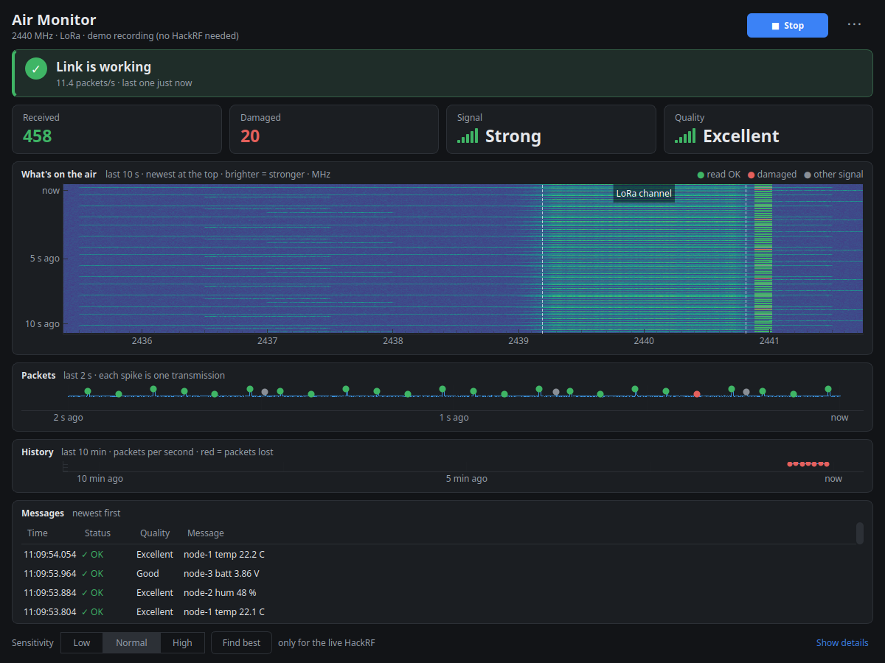

# Air Monitor

See what is happening on the 2440 MHz LoRa link of the swarm mesh radio, live, with a HackRF Pro.



## Quick start

1. Install the HackRF software: `sudo apt install hackrf`
2. Plug in the HackRF and run `./air-monitor`
3. Press **Start listening**.

No HackRF? Press **Try the demo**: it plays an example recording, so you can learn the screen first.

The first `./air-monitor` sets up the Python packages it needs (in `.venv`) if they are not installed already.

### On Windows

1. Install Python 3 from [python.org](https://www.python.org/downloads/) (tick **Add python.exe to PATH**).
2. Install the HackRF tools for Windows (`hackrf_transfer.exe` and `hackrf_info.exe`, for example from the
   PothosSDR bundle) and make sure their folder is on the `PATH`.
3. If Air Monitor says **HackRF not found** while it is plugged in, Windows needs its USB driver: run
   [Zadig](https://zadig.akeo.ie/), pick the HackRF and install **WinUSB**.
4. Double-click `air-monitor.bat` (the first start installs the Python packages), then press **Start listening**.

The demo works without the HackRF tools.

## Reading the screen

- **Status** (top): whether the link is working, in plain words, and what to do if it isn't. When the signal is
  too strong or too weak, it offers a button that changes the sensitivity for you.
- **Received / Lost / Signal / Quality**: packets read correctly since Start; the share that did not arrive
  intact (worked out from the nodes' packet numbers: damaged plus not heard at all); how loud the nodes are at the
  HackRF; and how clearly they stand out from the noise. For nodes without packet numbers the second tile is
  **Damaged**: packets that failed their check.
- **What's on the air**: a waterfall of the last 10 s, newest at the top; brighter means stronger. The dashed
  lines mark the LoRa channel, where each packet shows as a bright bar. The thin column beside it has a tick for
  every packet: green = read OK, red = damaged, grey = some other signal (Wi-Fi, Bluetooth…).
- **Packets**: the channel over the last 2 s. Each spike is one transmission; evenly spaced spikes are the nodes
  taking turns.
- **History**: packets per second over the last 10 minutes; red dots mark lost packets.
- **Messages**: what each packet said, newest first. The v0.1 nodes send a packet number ("Packet #2263").
- **Sensitivity**: Normal suits most cases. Use Low if the status says the signal is too strong, High if it is
  weak. **Find best** tries all three for a few seconds each and keeps the one that loses the fewest packets.
- **Show details**: the spectrum, the raw LNA/VGA gains, the technical columns (Δt, length, CRC, level, SNR,
  frequency error, duration, hex) and the receiver health.
- **⋯ menu**: play the demo or a recording, record raw radio data, alerts on/off, open the logs folder, help.

After **Stop**, the status line sums up the session and **View summary** shows all the numbers. If the HackRF is
unplugged (or Gqrx grabs it), the status says so and listening starts again by itself when it is back. When a
working link drops, you get a desktop notification (turn it off in the ⋯ menu).

Hover over anything for an explanation. Space starts and stops listening.

## Good to know

- The HackRF only receives. Keep it at least 1 m from a node that is transmitting (RF amp off).
- Only one program can use the HackRF at a time: close Gqrx first.
- Every packet heard is logged to `logs/air_<time>.csv`, and each session's summary to
  `logs/air_<time>.summary.txt`. "Record raw radio data" saves the raw signal (about 13 MB/s) to
  `logs/capture_<time>…iq`, to play back later with "Play a recording…".

## Radio settings

`air-monitor.toml` holds the nodes' radio settings; it comes set for the v0.1 firmware (2440.0 MHz, LoRa SF7,
1625 kHz, coding rate 4/5). Edit it when the nodes change:

```toml
[radio]
frequency_mhz = 2440.0      # channel centre, 2400-2500
spreading_factor = 7        # 7-10
bandwidth_khz = 1625        # 1625, 812.5, 406.25 or 203.125
coding_rate = 5             # 5-8, for 4/5 to 4/8
```

A wrong value stops Air Monitor at launch with a message saying which one. `--config FILE` uses another file.

## Tuning the sensitivity presets

`tools/bench_sweep.py` listens at a ladder of HackRF gains and prints, for each, the packets read, damaged and not
heard, the signal level and SNR. Close Air Monitor first, switch a node on, and run it at a few distances:

```bash
python3 tools/bench_sweep.py --csv sweep_1m.csv      # ~1.5 min; --lna/--vga/--seconds to change the ladder
```

The presets (`SENSITIVITY`) and limits (`CLIP_DB`, `WEAK_SNR_DB`) are at the top of `tools/link_health.py`.

## Command line

```bash
./air-monitor                         # same as: python3 tools/air_monitor.py
./air-monitor --demo                  # the example recording
./air-monitor --file CAP.iq           # play a recording
./air-monitor --lna 16 --vga 20       # start with these gains (default: the last sensitivity used)
./air-monitor --details               # open with the details shown
./air-monitor --autostart             # start listening at once
./air-monitor --config other.toml     # other radio settings
```

`./air-monitor --help` lists every option. Without the launcher: `pip install -r requirements.txt`, then
`python3 tools/air_monitor.py`.

## Files

- `air-monitor`, `air-monitor.bat`: the launchers (Linux/macOS, Windows).
- `tools/air_monitor.py`: the receiver (HackRF input, burst detection, LoRa decoding) and the command line.
- `tools/air_monitor_ui.py`: the window.
- `tools/link_health.py`: the plain-language rules: status line, ratings, sensitivity presets, "Find best",
  alerts, reconnecting and error messages. The thresholds to tune on the bench are at the top.
- `tools/payloads.py`: what the packets say, and lost-packet counting from the nodes' packet numbers.
- `tools/session.py`: one listening session: totals, 10-minute history and the summary.
- `tools/radio_config.py`: reads `air-monitor.toml`.
- `tools/bench_sweep.py`: the gain sweep for tuning the presets.
- `tools/demo_capture.py`: makes the demo recording (cached in the temp folder on first use).
- `tools/lora_phy.py`: LoRa encode/decode in plain Python, used to decode the packets.
- `tests/`: run with `python3 -m unittest discover tests`.
